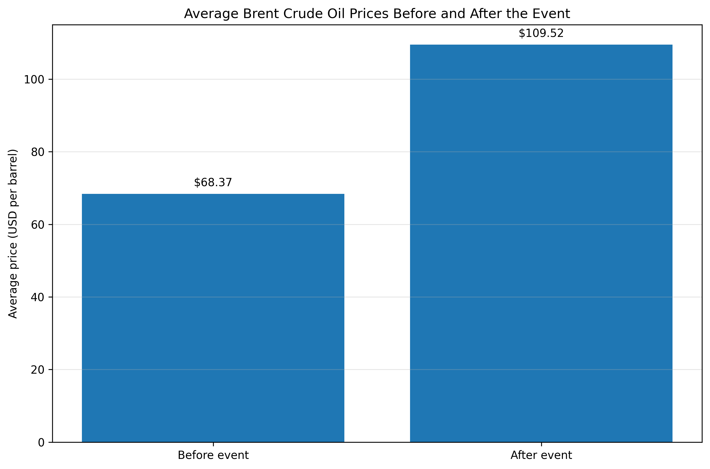
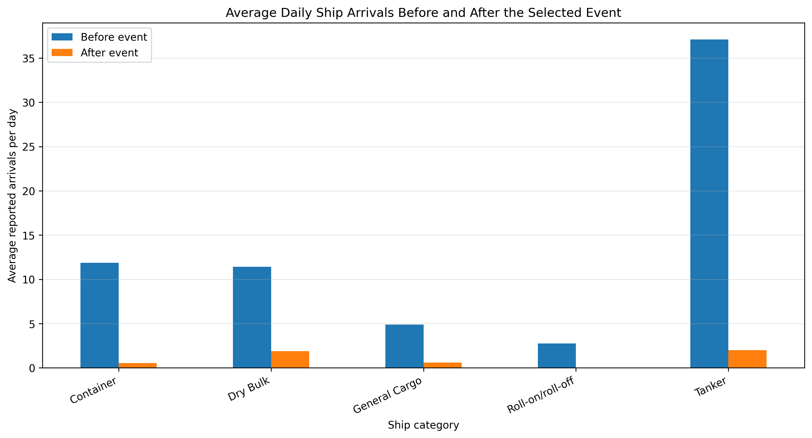
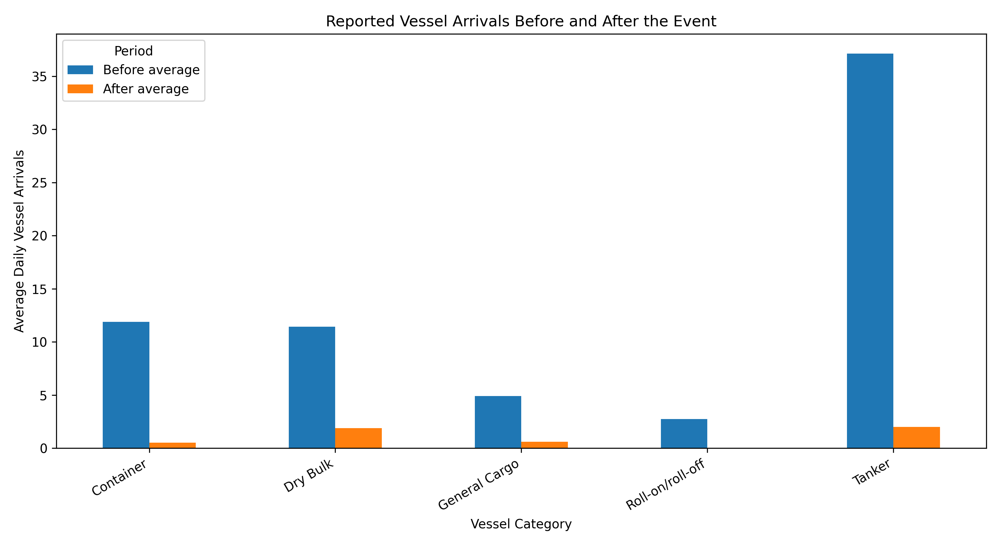

# Strait of Hormuz Conflict Impact Analysis

Strait of Hormuz Conflict Impact Analysis

1. Project Overview

This research project examines changes in Brent crude oil prices around the geopolitical conflict event dated February 28, 2026. It uses Python and publicly available oil price data to explore possible implications for global energy markets and supply chains.

2. Research Objectives

- Analyze Brent crude oil price trends before and after the selected event date.
- Compare average oil prices across two periods.
- Develop practical skills in Python, data analysis, and research visualization.
- Establish a foundation for further research on maritime trade and supply chain disruptions.

3. Preliminary Findings

The initial analysis found the following average prices:

Measure| Result
Average price before the event| $68.37 per barrel
Average price after the event| $109.52 per barrel
Difference| $41.15 per barrel
Percentage difference| 60.19%

These are preliminary descriptive results based on the selected periods. They do not prove that the conflict caused the price increase. Other market conditions may also have influenced oil prices.

4. Data and Tools

- Data source: Brent crude oil price series accessed through FRED, sourced from the U.S. Energy Information Administration.
- Programming language: Python
- Tools: Google Colab, pandas, and Matplotlib
- Data format: CSV
- Visualization: Brent crude oil price chart

5. Repository Contents

- "01_brent_oil_price_analysis.ipynb": Initial analysis and visualization.
- "02_oil_price_reliability_check.ipynb": Statistical summaries and reliability checks.
- "brent_oil_prices.csv": Oil price dataset.
- "brent_oil_price_chart.png": Saved oil price chart.

Note: Update the filenames above if your actual repository uses different names or folders.

6. Limitations

This project uses a before-and-after comparison. It does not establish causation, account for all external market influences, or independently measure shipping activity through the Strait of Hormuz. Further analysis is required.

7. Researcher

Tesfalem Habtamu
Logistics and Supply Chain Management
Addis Ababa University

8. Project Status

Initial oil price analysis completed. Further work will explore shipping activity, maritime trade, and potential supply chain implications.
 9. Data Visualizations

#Brent Crude Oil Prices Over Time

Average Oil Prices Before and After the Selected Event

The line chart illustrates daily Brent crude oil price movements. The bar chart compares average prices in the selected 60-calendar-day periods before and after February 28, 2026.

These visualizations show descriptive price differences. They do not establish that the conflict caused the observed increase.

10. Maritime Shipping Analysis

Preliminary Findings

The preliminary analysis of IMF PortWatch data shows a substantial decrease in reported daily ship arrivals across five vessel categories in the 60-day period following February 28, 2026. The combined daily average decreased from 68.07 before the selected event to 5.03 afterward, representing an approximate decline of 92.61%.

The largest percentage decreases were observed in roll-on/roll-off vessels (100%), container ships (95.51%), and tankers (94.61%). These results indicate a major change in recorded maritime activity during the comparison period.

However, the findings should be interpreted cautiously. PortWatch uses AIS-based vessel tracking, which can be affected by signal interruptions, GPS interference, spoofing, and vessels not transmitting. The before-and-after comparison also does not establish that the conflict alone caused the observed decline.

Data source: IMF PortWatch, Strait of Hormuz monitoring dashboard.

Method:** Comparison of average daily reported vessel counts across two 60-calendar-day periods surrounding February 28, 2026.

Visualization

11.  Combined Maritime Shipping and Cargo Analysis

This analysis compares reported vessel arrivals and estimated cargo volume during the 60 days before and after February 28, 2026, the selected event date.

The combined dataset presents average daily values for five vessel categories: container ships, dry bulk carriers, general cargo ships, roll-on/roll-off vessels, and tankers. It helps compare changes in recorded maritime activity and estimated cargo movement following the event.

 [Download the combined Hormuz analysis](combined_hormuz_summary.csv)

The results describe changes in the available data and do not, by themselves, establish that the conflict caused every observed change. AIS signal disruptions, GPS jamming, spoofing, and vessels switching off tracking systems may affect recorded vessel movements. Estimated cargo volume should also be interpreted as an estimate rather than official customs trade data.

Data Files

- `ship_arrivals_comparison.csv`: Summary of daily average vessel counts and percentage changes.
- `ship_arrivals_comparison.png`: Comparison chart for the five vessel categories.

#### Reported Vessel Arrivals: Before vs. After the Event

